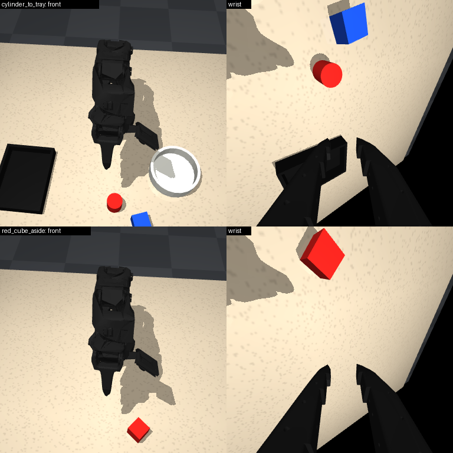
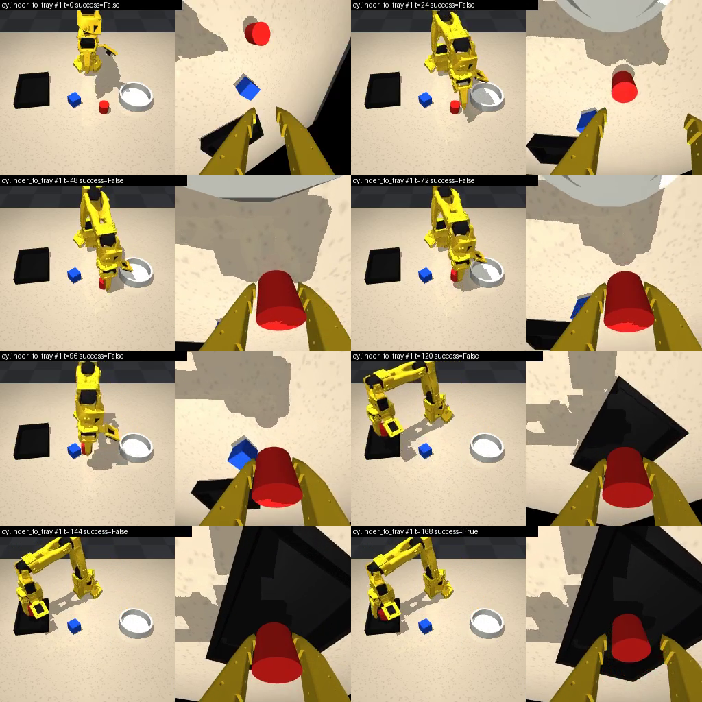

# so101-libero-mini

A small LIBERO-style manipulation benchmark for the **SO-101** arm in **MuJoCo**: a tabletop scene with a red
cylinder, a blue cube, a black tray and a circular container; declarative tasks with language instructions,
randomized layouts and physical success predicates; an automatic, physics-verified expert; LeRobot datasets
(format v3.0, lerobot 0.4.2); LeRobot policy training (ACT, SmolVLA); and a fixed-init-state evaluation with videos and success rates.

Everything is contact simulation: the expert and the learned policies move the arm with joint-position commands;
objects are grasped by friction between the jaws (no welds, no teleporting, no attachment).

| | |
|---|---|
|  |  |
| Scene: front camera, wrist camera (both policy inputs), overview | A trained ACT policy solving Task 1 (front + wrist) |

Videos: [expert, Task 1](docs/media/expert_cylinder_to_tray_seed0.mp4) ·
[expert, relative placement](docs/media/expert_cylinder_left_of_cube_seed300000.mp4) ·
[ACT policy, Task 1](docs/media/policy_act_t1_200_80k_ep001_success.mp4). Design notes, problems found and
fixed, and the adversarial review: [docs/DESIGN.md](docs/DESIGN.md).

## Status

| component | status |
|---|---|
| SO-101 MuJoCo scene, cameras, physics | implemented, tested (unit tests, 1000+ expert episodes) |
| task framework (4 tasks, 2 suites), success predicates, fixed evaluation states | implemented, tested (edge cases from the review are unit tests) |
| scripted expert + demonstration generator (+ optional recovery demonstrations) | implemented, tested (100 % on the evaluation states) |
| LeRobot datasets + validation (incl. open-loop replay) + bit-exact regeneration | implemented, tested on all datasets |
| ACT single-task training + evaluation | tested: **94 %** (47/50) on Task 1 |
| ACT with recovery demonstrations | tested: 94 % already at 40k steps (baseline 74 %) |
| SmolVLA language-conditioned multi-task (3 tasks) | trained and evaluated: works but far from ACT's level (see Results) |
| relative-placement task (`cylinder_left_of_cube`) | expert + evaluation states only; no dataset / policy trained yet |
| scene matched to the physical setup (near-black arm, measured front camera; `docs/real_setup/`) | implemented, home-pose render checked against the photo |
| task `red_cube_aside` for the physical setup (zone predicate with a lift requirement, expert plan, 50 frozen states) | implemented, tested (expert 80/80 on training seeds, 97/100 with recovery grasps) |
| appearance domain randomization for sim-to-real (`--visual-rand`) | implemented, unit-tested, rendered samples checked |
| ACT policy for the real setup (nominal and randomized data) | see Results (real-setup rows) |
| real-robot deployment script (`scripts/real/run_policy.py`) + camera check | implemented, tested end to end in the simulator; **not yet run on hardware** |

## Architecture (and why)

| option | verdict |
|---|---|
| **MuJoCo directly (chosen)** | Installed (3.3.7); headless via EGL (GPU) or OSMesa (CPU); MuJoCo Menagerie has a tuned SO-101 model with primitive jaw collisions that grasp reliably (TheRobotStudio's MJCF uses convex jaw hulls that cannot pinch a 3 cm object). Full control over scene, contacts and timing; easy to debug. |
| robosuite / LIBERO | Would need robosuite 1.4 + MuJoCo 2.3, a custom SO-101 robot and gripper class, and an OSC controller made for 7-DoF arms. Heavy, conflicts with the installed stack. LIBERO's *design* is reused instead: declarative tasks, placement regions, goal predicates, frozen evaluation states. |
| LeRobot sim envs | gym_aloha / pusht / xarm / LIBERO / MetaWorld: none has an SO-101. LeRobot is used for datasets, training and policy loading. |
| SAPIEN / ManiSkill (previous attempt) | Vulkan rendering only works outside Apptainer on Hopper GPU nodes. |

Key choices:
- **Robot model:** Menagerie `robotstudio_so101` vendored unmodified (`assets/robotstudio_so101`, commit `62ab00f`).
  Scene-specific changes are applied with `mujoco.MjSpec` (`so101_libero/sim/scene.py`): 2.08 ms timestep (16
  substeps per 30 Hz control step), elliptic cones, `multiccd` (flat faces on flat faces need a contact patch:
  without it the cylinder rocks and sinks), gripper torque capped at 1.2 N·m (the real follower runs the gripper at
  50 % torque), elbow capped at 90° (beyond, the forearm hits the shoulder), a low collider on the robot base, and
  a TCP site between the jaws.
- **Interface = the real robot's:** `observation.state` and `action` are the six `so101_follower` motor values in
  LeRobot units with `use_degrees=True` (degrees for the 5 arm joints, gripper 0..100). Actions are absolute joint
  targets. Cameras: `observation.images.front` (third-person) and `observation.images.wrist`, 256×256, 30 fps.
- **Expert:** damped-least-squares IK on the TCP with checked convergence; top-down grasps with the least outward
  tilt that is reachable, smooth tilt profiles; min-jerk timing (segments sized for a 75°/s *average* joint speed;
  with the ×0.9-1.15 timing randomization the commanded peaks reach ~157°/s); collision-checked grasp yaw; physics
  checks at every phase boundary (grasped, lifted, still held, placed).
- **Learning:** ACT as the single-task baseline (reliable with a few hundred demos, fast, widely used on real
  SO-101); SmolVLA for the language-conditioned multi-task policy (LeRobot's VLA built for SO-100/101).

## Layout

```
assets/robotstudio_so101/          vendored MJCF + meshes (Apache-2.0); *_lowpoly/: decimated visual meshes
so101_libero/
  sim/robot.py                     joint names, LeRobot unit conversion, home pose
  sim/objects.py                   object / container specs and builders
  sim/scene.py                     MjSpec scene: robot + table + items + cameras + physics options
  tasks/base.py                    Region, Layout (placement sampling), WorldState, predicates, plans, Task
  tasks/registry.py                the tasks and suites  <- add tasks here
  tasks/tri_tasks.py               suite so101_tri: scene, directions, 5 placements, tolerances, 3 tasks (docs/TRI_TASKS.md)
  expert/tri_tasks.py              so101_tri demonstration controllers (side grasp + carry aside, tip the cube over, push)
  train/lerobot_train_balanced.py  lerobot-train with task-balanced sampling (multitask datasets)
  env.py                           gymnasium env (the policy-facing observation/action interface)
  expert/                          ik.py, pick_place.py (expert), rollout.py (episode runner + grasp monitor)
  data/writer.py                   LeRobot dataset writer (+ side metadata: seeds, init states, failures)
  policy/runner.py                 load a LeRobot checkpoint + its saved processors; act(observation, instruction)
  cli/                             check_env, generate, validate_dataset, check_reproducibility, make_init_states,
                                   evaluate, summarize, render_video
init_states/<task>.json            frozen evaluation states (50 per task, expert-verified, seeds >= 10,000,000)
scripts/env.sh                     run anything in the runtime (Singularity image + venv + GL + thread settings)
scripts/train.sh                   lerobot-train wrapper with project defaults (presets: act, diffusion, smolvla)
scripts/eval_variants.sh           evaluate one checkpoint with several inference settings
scripts/setup_*.sh                 one-time setup (OSMesa, EGL shim, SmolVLA extras; conda runtime for SLURM)
pbs/                               Hopper GPU jobs: smoke, generate, train (+eval), eval (+ small diagnostics)
slurm/train_smolvla_*.slurm        so101_tri SmolVLA jobs (cylinder_side, cube_flip, green_push, multitask; settings in
                                   slurm/tri_tasks.env; every checkpoint evaluated), wrappers like the stacking job
slurm/                             SLURM H100 jobs, SmolVLA end to end (conda env, data, train, eval): red_cube_to_box,
                                   red_cube_to_black_box, stack_red_on_blue (each: its defaults on top of the shared
                                   driver smolvla_job.sbatch; 100 demos, 100k steps, checkpoints and evaluation every 20k)
tests/                             pytest (physics-only) + render / EGL diagnostics
docs/                              DESIGN.md, media/, results/ (stored measurement outputs)
```

## Setup (once)

The runtime is the existing venv `/scratch/e1583535/virtualenvs/lerobot042-act`, created inside the PyTorch image
`/app1/common/singularity-img/hopper/pytorch/pytorch_2.7.0_cuda_12.8.sif` with `--system-site-packages` (it uses
the image's torch). `scripts/env.sh` enters both and sets caches (`HF_HOME`, `HF_LEROBOT_HOME`, `TORCH_HOME`),
`HF_HUB_OFFLINE=1`, rendering and thread pools. Nothing in this project installs into the venv.

```bash
bash scripts/setup_osmesa.sh       # CPU rendering (login node, CPU-rendered jobs): conda-forge mesalib in its own
                                   #   prefix via /scratch/e1583535/opt/micromamba
bash scripts/setup_egl_shim.sh     # GPU rendering in the image: libGLdispatch + NVIDIA EGL vendor file
bash scripts/setup_smolvla.sh      # only for SmolVLA: transformers & co. in an overlay dir + model download
```
Clusters without the image (the SLURM job in `slurm/`) use a conda env instead: `bash scripts/setup_conda_env.sh`
(conda-forge python 3.10 + lerobot[smolvla] 0.4.2, mujoco 3.3.7, OSMesa, SmolVLA weights; the job runs it itself).
ACT's ImageNet ResNet18 weights must be in `/scratch/e1583535/cache/torch/hub/checkpoints` (`$TORCH_HOME`; they are,
`check_env` reports it). Harmless messages: Singularity's "Could not find any nv files" on CPU nodes, and MuJoCo's
"Nan, Inf or huge value in QVEL" from the divergence unit test (logged to `MUJOCO_LOG.TXT`).
`scripts/decimate_meshes.py` regenerates `assets/robotstudio_so101_lowpoly` (the decimated meshes are included).
Rendering: `SO101_RENDER=auto` (default: EGL on GPU nodes, OSMesa elsewhere) `| egl | osmesa | none`. With OSMesa,
import `so101_libero` before `mujoco` (it preloads libOSMesa).

## Commands (from the project root)

The examples write new outputs (`my_*` names). The datasets and runs reported below already exist under the names in
Results; re-running `generate` on an existing repo id stops (`--overwrite` replaces it), re-submitting a finished
training run only resumes it and re-evaluates.

```bash
# 1. environment + simulation tests
bash scripts/env.sh python -m so101_libero.cli.check_env                      # packages, GPU, rendering, IK (~20 s)
bash scripts/env.sh python -m pytest -q tests -p no:cacheprovider              # physics unit tests (~10 s)
SO101_RENDER=none bash scripts/env.sh python -m so101_libero.cli.evaluate --policy expert \
    --tasks so101_mini so101_extra --episodes 50 --no-render --workers 6     # expert on all frozen states (~15 s)
bash scripts/env.sh python -m so101_libero.cli.render_video --task cylinder_to_tray --seeds 0 1 --out outputs/videos
bash scripts/env.sh python -m so101_libero.cli.render_video --task red_cube_aside --seeds 400000 --out outputs/videos

# 2. demonstrations -> LeRobot dataset (/scratch/e1583535/datasets/lerobot/<repo-id>), validation, reproducibility
bash scripts/env.sh python -m so101_libero.cli.generate --tasks cylinder_to_tray --num-demos 200 --workers 8 \
    --repo-id local/my_t1_200      # ~45 min on the login node (OSMesa); + --max-grasp-retries 2 --miss-prob 0.3
                                   # for recovery demos; + --legacy-expert to reproduce the existing datasets
bash scripts/env.sh python -m so101_libero.cli.validate_dataset --repo-id local/my_t1_200 --replay-episodes 10
bash scripts/env.sh python -m so101_libero.cli.check_reproducibility --repo-id local/so101_mini_t1_200 --episodes 30
qsub -v TASKS=so101_mini,NUM_DEMOS=200,REPO_ID=local/my_all_200 pbs/generate.pbs   # GPU node (EGL), ~55 min
# real-setup task: recovery grasps (cube-sized miss offset), 3 deg start-pose noise; add --visual-rand for randomized looks
qsub -l walltime=01:00:00 -v TASKS=red_cube_aside,NUM_DEMOS=300,REPO_ID=local/my_real_cube_300,GEN_ARGS="--max-grasp-retries 2 --miss-prob 0.3 --miss-offset 0.018 0.026 --home-noise-deg 3 --visual-rand" pbs/generate.pbs
# red cube (2.7-4 cm) into the black box (the miss offset is for a 3 cm cube; the expert shifts it by the size difference)
qsub -l walltime=03:00:00 -v TASKS=red_cube_to_box,NUM_DEMOS=500,REPO_ID=local/so101_real_cube_box_500,GEN_ARGS="--max-grasp-retries 2 --miss-prob 0.3 --miss-offset 0.018 0.026 --home-noise-deg 3" pbs/generate.pbs

# 3. training (GPU); pbs/train.pbs then evaluates the last checkpoint on the frozen states (OSMesa rendering)
qsub -v REPO_ID=local/my_t1_200,OUT=outputs/train/my_act_t1,STEPS=80000 pbs/train.pbs     # ~75 min + ~13 min eval
# real-setup task with W&B logging (training curves + the final simulated evaluation go to the same run)
qsub -W depend=afterok:<gen_job> -l walltime=03:00:00 -v REPO_ID=local/my_real_cube_300,OUT=outputs/train/my_act_real_cube,STEPS=80000,EVAL_TASKS=red_cube_aside,WANDB=true,WANDB_PROJECT=cs6283,WANDB_ENTITY=tsangb34-national-university-of-singapore-students-union pbs/train.pbs
qsub -v POLICY=smolvla,REPO_ID=local/my_all_200,OUT=outputs/train/my_smolvla,STEPS=25000,BATCH_SIZE=32,SAVE_FREQ=5000,EVAL_TASKS=so101_mini -l walltime=05:00:00 pbs/train.pbs
# SmolVLA's cosine schedule decays over policy.scheduler_decay_steps (30000 in smolvla_base), NOT over STEPS: for longer
# runs pass it too, else the learning rate sits at its 2.5e-6 floor after 30k steps (~0.17 s/step at batch 32 on an H200)
qsub -W depend=afterok:<gen_job> -l walltime=06:30:00 -v POLICY=smolvla,REPO_ID=local/so101_real_cube_box_500,OUT=outputs/train/smolvla_real_cube_box_500,STEPS=80000,BATCH_SIZE=32,SAVE_FREQ=20000,EVAL_CKPTS=all,EVAL_TASKS=red_cube_to_box,TRAIN_ARGS=--policy.scheduler_decay_steps=80000,WANDB=true,WANDB_PROJECT=cs6283,WANDB_ENTITY=tsangb34-national-university-of-singapore-students-union pbs/train.pbs
# the same red_cube_to_box run on a SLURM H100 node as one job: conda env, generation if the dataset is missing,
# training, evaluation; resubmitting resumes (variables in the script header)
WANDB=true WANDB_PROJECT=cs6283 WANDB_ENTITY=tsangb34-national-university-of-singapore-students-union sbatch slurm/smolvla_red_cube_to_box.sbatch
# the two in-view real-setup tasks (start and park at rest; 100 demos, 100k steps, checkpoints + evaluation every 20k)
sbatch slurm/smolvla_red_cube_to_black_box.sbatch
sbatch slurm/smolvla_stack_red_on_blue.sbatch
qsub pbs/smoke.pbs                       # ~3 min plumbing test of every stage (log ends "SMOKE TEST PASSED")

# 4. evaluation of a checkpoint (videos, results.json, episodes.csv, success rate + Wilson 95% CI)
SO101_RENDER=osmesa bash scripts/env.sh python -m so101_libero.cli.evaluate \
    --policy outputs/train/act_t1_200/checkpoints/last/pretrained_model --tasks cylinder_to_tray \
    --episodes 50 --videos 10 --workers 6 --out outputs/eval/my_act_t1_last    # ~10 min, CPU node or GPU node
#   + --visual-rand: the same frozen states under randomized lighting/colours/camera jitter (robustness check)
qsub -v CKPT=outputs/train/smolvla_all_200/checkpoints/025000/pretrained_model,TASKS=so101_mini,OUT=outputs/eval/my_smolvla pbs/eval.pbs
bash scripts/eval_variants.sh <checkpoint> <out_dir> cylinder_to_tray n50 n10 te   # inference settings
bash scripts/env.sh python -m so101_libero.cli.summarize outputs/train/*/eval*/*/results.json   # markdown table
bash scripts/collect_results.sh                                               # copy summaries to docs/results/eval
```

Where things go: datasets in `/scratch/e1583535/datasets/lerobot/<repo-id>` (side files in its `meta/`);
dataset checks in `outputs/dataset_checks/<name>/`; checkpoints in `<OUT>/checkpoints/<step>/pretrained_model`;
evaluations in `--out` (default `outputs/eval/<run>_<checkpoint>`), or `<OUT>/eval/last_<step>/` for `train.pbs`
and `$OUT/` for `eval.pbs`; PBS job logs in `logs/pbs/<jobid>.log`; the smoke test's throwaway data in
`/scratch/e1583535/tmp/so101lm_smoke_<jobid>/`. The smoke test only proves that every stage runs (its 200-step
policy is expected to fail).

### Training defaults (`scripts/train.sh`, override with environment variables or extra flags)

| | ACT (`POLICY=act`, default) | SmolVLA (`POLICY=smolvla`) |
|---|---|---|
| init | ImageNet ResNet18 backbone | `lerobot/smolvla_base` (VLM frozen, action expert trained; 100M of 450M params) |
| chunk / executed per inference | 50 / 50 | 50 / 50 |
| batch, steps (used here) | 16, 80k (default 60k) | 32, 25k |
| optimizer | AdamW lr 1e-5 (LeRobot default) | AdamW lr 1e-4, cosine decay with warmup (LeRobot preset) |
| other | `--dataset.video_backend=pyav` (torchcodec does not load in this image), seed 1000, checkpoints every 10k (`SAVE_FREQ`), no W&B unless `WANDB=true` | cameras renamed front→camera1, wrist→camera2 |
| time on one H200 | ~0.055-0.065 s/step (80k ≈ 70-85 min) | ~0.17 s/step (25k ≈ 73 min) |

CPU smoke variant (login node): `STEPS=2 BATCH_SIZE=2 SAVE_FREQ=2 NUM_WORKERS=1 bash scripts/train.sh <repo> <out> --policy.device=cpu`.

### Rendering in evaluation

The PBS jobs evaluate with **OSMesa (CPU) rendering and the policy on the GPU**; for direct commands on a GPU node set
`SO101_RENDER=osmesa` (the automatic choice there is EGL). EGL contexts next to CUDA aborted on some Hopper nodes (once even in a single process, once with several worker processes although a
single-process self-test passed). OSMesa and EGL renders of the same state differ by < 1/255 on average
(`docs/results/render_backend_comparison.txt`). `evaluate` records the renderer and warns when it differs from the
training data's or when the scene changed since the data was generated; episodes run in worker processes, so a
native crash costs a retry of that episode, not the evaluation.

## Conventions

- World frame: robot base at the origin on the table top (z = 0), facing +x; +y is the robot's left. The front
  camera faces the robot, so the robot's left appears on the right of the image. The front camera is the real one
  (measured, `docs/real_setup/PROMPT.md`): 67 cm from the base, looking down 56°, vertical FOV 45° of the square image;
  the table is visible up to ~0.26 m in front of the base.
- Units: arm joints in degrees, gripper 0 (closed) .. 100 (open), mapped linearly onto the model's -10°..100°.
  Sim zero = LeRobot calibration midpoint (Menagerie derives from `so101_new_calib`). For a real follower with the
  default `use_degrees=False` (values in ±100), convert per joint with its calibration range before deployment.
- Timing: frame *t* stores the observation before action *t* is applied (`action_t ≈ state_{t+1}`). Images and
  contacts are one 2 ms physics substep behind `observation.state` (≤ 0.35° of arm motion; kept for bit-exactness).
- Privileged state (object poses, contacts, seeds) is used only by the expert, success checks and failure
  diagnostics; datasets keep it only in `meta/so101_libero*` side files that no LeRobot policy reads; the policy
  runner refuses checkpoints that expect inputs other than state + the two cameras (SmolVLA's unused third camera
  slot excepted).

## Tasks

Suite `so101_mini` (one shared layout, LIBERO-Goal style: the instruction decides what to do):

| id | instruction | goal |
|---|---|---|
| `cylinder_to_tray` | Pick up the red cylinder and place it inside the black tray. | In(red_cylinder, black_tray) |
| `cylinder_to_container` | Pick up the red cylinder and place it inside the circular container. | In(red_cylinder, round_container) |
| `cube_to_tray` | Pick up the blue object and place it inside the black tray. | In(blue_cube, black_tray) |

Suite `so101_extra` (other goal type, same items; the cube starts right of centre):

| id | instruction | goal |
|---|---|---|
| `cylinder_left_of_cube` | Move the red object to the left of the blue object. | LeftOf(red_cylinder, blue_cube) |

Suite `so101_real` (the physical setup of `docs/real_setup/PROMPT.md`: a red cube, plus a container or a blue cube, on an otherwise empty table; registry index 4,
training seeds 400000+, evaluation seeds 10,400,000+):

| id | instruction | goal |
|---|---|---|
| `red_cube_aside` | Pick up the red cube and place it aside. | OnTableIn(red_cube, aside_zone): zone x 0.08-0.18, y 0.13-0.20 m (the robot's left = the lower right of the front image) |
| `red_cube_to_box` | Pick up the red cube and put it in the black box. | In(red_cube, black_tray); cube edge 2.7-4.0 cm per episode, tray on the robot's left (index 5: training seeds 500000+, evaluation 10,500,000+) |
| `red_cube_to_black_box` | Pick up the red cube and put it in the black box. | In(red_cube, black_box); like `lerobot/svla_so100_pickplace`: the box (10 × 10 cm outside, 6 cm walls) on the robot's right, the cube on its left beside the folded arm (6 cells, cell = seed % 6), all inside the front camera's view; starts and parks at rest (index 8: training seeds 800000+, evaluation 10,800,000+) |
| `stack_red_on_blue` | Put the red cube on top of the blue cube. | On(red_cube, blue_cube); like `lerobot/svla_so100_stacking`: two 3 cm cubes on the robot's left, the blue one always 10 cm further left, the pair moved as one (4 cells, cell = seed % 4); starts and parks at rest (index 9: training seeds 900000+, evaluation 10,900,000+) |

Suite `so101_tri` (one scene: a fixed white tray on the robot's right, an all-red cube, a green
half-cylinder and a light gray cylinder; exactly five placements of the three small objects; registry indices 13, 14, 16;
full description, commands and limitations in [docs/TRI_TASKS.md](docs/TRI_TASKS.md)):

| id | instruction | goal |
|---|---|---|
| `cylinder_aside` | Pick up the light gray cylinder and put it aside. | OnTableIn(gray_cylinder, aside_zone: the robot's left, beside the base), upright, carried ≥ 2 cm high, others undisturbed; side-grasp demonstrations (wrist camera on top, 45° approach) |
| `cube_flip` | Pick up the red cube and flip it onto its side. | TurnedOnSide(red_cube): its top face turned sideways (tracked body orientation), resting flat ≤ 2 cm from its start, lifted, others undisturbed |
| `green_push_forward` | Push the green semicircular block forward 5 cm. | PushedBy(green_block, 5 cm forward ± 1 cm, ≤ 1.5 cm sideways), still flat, never carried, others undisturbed |

Suite `so101_three_cubes` (one scene: plain 3 cm red, yellow and green cubes; five global layouts; every episode starts at
HOME and ends with the deterministic stop → release → retreat → HOME controller; registry indices 17, 18, 21; full
description, commands, direct (no SLURM) scripts and limitations in [docs/THREE_CUBES.md](docs/THREE_CUBES.md)):

| id | instruction | goal |
|---|---|---|
| `flip_red_cube` | Flip the red cube and place it back at its original position. | FlippedInPlace(red_cube): tracked orientation turned ≥ 150° (one-grasp 180° roll about the 45° approach), top face no longer up, flat, ≤ 2 cm from its start, released; yellow/green undisturbed |
| `sort_ryg` | Arrange the cubes from left to right as red, yellow, green. | SortedRow: each cube ≤ 2 cm from its target in a 5 cm-spaced row (robot's left to right), released; 5 starting permutations × 5 layouts |
| `build_pyramid` | Place the green cube centered on top of the red and yellow cubes. | OnTopOfPair(green; red, yellow): ≤ 1 cm from their midpoint, on both, off the table, released; the base moved ≤ 1 cm |

Items and start regions (world frame, metres: x forward from the base origin, which lies 3.9 cm behind the shoulder's pan axis, y = the robot's left; uniform x, y, yaw; collision-free rejection sampling with 2 cm
clearance; the arm starts at a fixed home pose):

| item | size | mass | start region x / y / yaw |
|---|---|---|---|
| red cylinder | Ø3 cm × 3 cm | 20 g | 0.16-0.26 / -0.07-0.07 / any |
| blue cube | 3 cm | 20 g | 0.16-0.26 / -0.07-0.07 / ±45° (spatial task: 0.17-0.25 / -0.08 to -0.02) |
| black tray | inner 12 × 9 cm, walls 2.5 cm | 200 g | 0.15-0.21 / -0.19 to -0.13 / ±15° |
| circular container | inner Ø9 cm, walls 3 cm | 150 g | 0.15-0.21 / 0.13-0.19 / any |
| red cube (`so101_real` only) | 3 cm (`red_cube_to_box`: 2.7-4.0 cm, uniform per episode) | 20 g | 0.14-0.24 / -0.08-0.08 / ±45° |
| black tray (`red_cube_to_box`) | as above | 200 g | 0.13-0.17 / 0.13-0.17 / ±10° (the robot's left) |
| black box (`red_cube_to_black_box`) | 10 × 10 cm outside (5 mm walls, inner 9 × 9 cm), 6 cm tall | 1 kg (fix it on the real table) | 0.13-0.15 / -0.14 to -0.12 / ±5° (the robot's right: centre 10 cm ahead of the pan axis, 13 cm right; < 1 cm further right its rim leaves the camera image) |
| red cube (`red_cube_to_black_box`) | 3 cm | 20 g | 2 × 3 grid over 0.16-0.22 / 0.06-0.12 / ±45° (cell = seed % 6; the robot's left, ≥ 3.5 cm from the folded arm) |
| red + blue cube (`stack_red_on_blue`) | 3 cm each | 20 g each | red: 2 × 2 grid over 0.15-0.21 / 0.06-0.09 / ±45° (cell = seed % 4); blue: red + (0, +0.10) exactly, own yaw ±45° (the finished stack stays ≥ 6 cm clear of the folded arm) |

Success predicates (pure functions of the simulator state, `so101_libero/tasks/base.py`):
- `In(obj, container)`: the container stands upright (< 30° tilt) on the table, untouched and at rest; the object's
  centre is ≥ 3 mm inside the inner walls and above the floor, its bottom within 1 cm of the floor (not held above
  it, not on a wall top); the object is released (no robot contact) and at rest (< 5 cm/s).
- `LeftOf(obj, ref)` ("left" = the robot's left, +y): obj is ≥ 4 cm further left than ref and within 6 cm of it
  front/back (x); both rest directly on the table (not in a container), untouched and at rest; ref moved < 1 cm since the
  start (moving the reference instead of the object does not count).
- `OnTableIn(obj, zone)` (`red_cube_aside`): obj rests directly on the table with its centre inside the zone, upright (< 30°),
  released and at rest, ≥ 4 cm from its start, **and was raised ≥ 2 cm at some point in the episode** (the environment
  tracks the highest point each object reached; pushing the cube into the zone is not "picking it up").
- `On(obj, base)` (`stack_red_on_blue`): obj's bottom within 4 mm of base's top and its centre ≤ 12 mm (horizontally)
  from base's centre (over base's top face for 3 cm cubes); base rests directly on the table (it may have been
  nudged); both upright (< 20°), released and at rest, with the gripper's TCP ≥ 4 cm from obj (it let go and moved
  off: a stack knocked over while the open jaws are still around it does not count).
- A goal must hold for 5 consecutive control steps. Episodes end on success, if an object leaves the table, if the
  simulation diverges (MuJoCo's auto-reset would otherwise teleport everything to the origin), or after 450 steps
  (15 s). Initial states in which the goal already holds are resampled. Expert demonstrations continue past success
  (release, retreat, hold), evaluation stops at success.

Evaluation uses the 50 frozen states per task in `init_states/` (episode k = state k), sampled from seeds
disjoint from training (`generate` refuses seeds ≥ 10,000,000), each verified solvable by the expert, stored with a
scene hash and a rules hash.

**Adding a task:** append it in `so101_libero/tasks/registry.py` (tasks are only appended: the registry index sets
each task's seed range; a removed task is `retire`d so its slot stays reserved). A pick-and-place goal is one line (`pick_place(...)`); a new goal type needs a predicate
(`WorldState -> bool`) and, for demonstrations, an expert plan (see `PlaceRelative`). New items go in
`sim/objects.py` and a `Layout`; changing the scene changes its hash, so rebuild the evaluation states with
`bash scripts/env.sh python -m so101_libero.cli.make_init_states --tasks <suite or id> --force`.

## Real-world deployment (`docs/real_setup/`)

`docs/real_setup/PROMPT.md` is the measured physical setup (front camera pose/FOV, black arm) that the simulation now
reproduces; `docs/real_setup/DEPLOY.md` is the deployment guide for the red-cube policy: what the policy expects
(camera placement, units, home pose, cube), the checklist (calibration zero, camera alignment, dry run), and the two
ways to run it — `scripts/real_act.sh` (your `lerobot-rollout` wrapper with the crop/resize deploy copy) or
`scripts/real/run_policy.py` (standalone loop with go-home, per-step clamps and logging; `--robot sim` runs the same
code path in the simulator). `scripts/real/check_cameras.py` blends the real front camera with the sim render.

## Reproducibility

- Every dataset records its seeds, initial states, expert configuration, code / scene / rules hashes, BLAS setup
  and a snapshot of the source code (`meta/so101_libero.json`, `meta/so101_libero_src.tar.gz`).
  `check_reproducibility` regenerates episodes from their seeds and compares actions bit for bit.
- The four datasets listed below use the expert as it was before two IK fixes (mirrored fallback seeds; tilt aimed
  at the TCP instead of the wrist-roll axis): three were generated before the fixes, the recovery dataset
  deliberately with `--legacy-expert` for a clean comparison. All record `legacy_ik: true` and regenerate
  bit-identically with `generate ... --legacy-expert`. The default expert's demos for the same seeds differ by > 1°
  in ~10 % of episodes and are not bit-identical in ~58 % (all still succeed).
- Bit-exactness also needs the same OpenBLAS threading: `env.sh` pins it to 2 threads (a 1-thread pool, e.g. in a
  1-CPU cpuset, rounds `np.linalg.solve` differently at 1e-11). Policy evaluations are deterministic for the same
  worker / thread setup; CPU-vs-GPU inference or a different thread count can change trajectories slightly.

## Results

All numbers were measured in this project on 2026-10-17. Stored outputs: `docs/results/` (JSON copies of every
evaluation and check); videos and full logs under `outputs/` and `logs/` (not versioned).

**Simulation and expert**

| check | result | evidence |
|---|---|---|
| expert, fresh training-distribution seeds | 398/400 (3 tasks 100/100; relative placement 98/100, 2 plans rejected by the expert's jaw-clearance check) | `docs/results/expert_random_seeds.json` |
| expert, frozen evaluation states | 200/200 (50 per task, 4 tasks), ~138 steps (4.6 s) per episode | `docs/results/eval/eval__expert_physics_only.json` |
| expert during dataset generation | Task 1: 200/200 (OSMesa); 3 tasks: 600/600 (EGL); recovery: 200/202 | dataset `meta/so101_libero.json` |
| grasp while carrying: slip / penetration / pinch force | median 0.47-0.53 mm, max 2.19 mm / 1.05-1.43 mm / ~33 N | `docs/results/dataset_stats.json` |
| peak commanded arm joint speed | 157.5°/s (75°/s average per segment) | `docs/results/dataset_stats.json` |
| dataset validation (LeRobot loader, timing, videos, open-loop replay of 10 spread episodes; all 5 for the 5-demo set) | PASS for all datasets: replayed states equal the recorded ones, goal reached | `outputs/dataset_checks/*/validation.json` |
| regeneration from seeds | 30/30 episodes bit-identical for each of the 3 datasets | `docs/results/reproducibility_*.json` |
| OSMesa vs EGL renders of the same states | mean abs. difference ≤ 0.98/255, p99 ≤ 6/255 (edges) | `docs/results/render_backend_comparison.txt` |
| unit tests | 20 passed | `pytest tests` |

**Datasets** (`$HF_LEROBOT_HOME/local/...`, LeRobot v3.0, 30 fps, 256×256 front + wrist, AV1)

| repo id | episodes / frames | tasks | renderer |
|---|---|---|---|
| `so101_mini_t1_5demos` | 5 / 870 | cylinder_to_tray (first milestone) | OSMesa |
| `so101_mini_t1_200` | 200 / 34,656 | cylinder_to_tray | OSMesa |
| `so101_mini_t1_200_recovery` | 200 / 39,695 (60 with a deliberate first-grasp miss + regrasp) | cylinder_to_tray | OSMesa |
| `so101_mini_all_200` | 600 / 104,065 | the 3 so101_mini tasks | EGL |

**Policies** (frozen evaluation states, 50 episodes per task; success = goal predicate in the simulator)

Single task `cylinder_to_tray` (ACT, chunk 50, batch 16; trained on OSMesa-rendered data):

| data | checkpoint / inference | success | 95% CI | eval renderer | failures |
|---|---|---|---|---|---|
| `so101_mini_t1_200` | 20k | 33/50 = 66 % | 52-78 | OSMesa | never lifted 17 |
| 〃 | 40k | 37/50 = 74 % | 60-84 | OSMesa | never lifted 9, dropped/misplaced 3, fell off the table 1 |
| 〃 | 60k | 45/50 = 90 % | 79-96 | OSMesa | never lifted 4, misplaced 1 |
| 〃 | **80k** | **47/50 = 94 %** | 84-98 | OSMesa (= training) | never lifted 2, misplaced 1 |
| 〃 | 80k | 49/50 = 98 % | 90-100 | EGL (other renderer) | misplaced 1 |
| 〃 | 80k, re-plan every 10 actions | 23/50 = 46 % | 33-60 | OSMesa | never lifted 19, ... |
| 〃 | 80k, temporal ensembling (every step) | 40/50 = 80 % | 67-89 | OSMesa | never lifted 9, misplaced 1 |
| `so101_mini_t1_200_recovery` | 20k | 38/50 = 76 % | 63-86 | OSMesa | never lifted 5, misplaced 4, ... |
| 〃 | 40k | 47/50 = 94 % | 84-98 | OSMesa | 1 each: never lifted, misplaced, not settled |
| 〃 | 60k | 45/50 = 90 % | 79-96 | OSMesa | misplaced 3, never lifted 1, still held 1 |
| 〃 | 80k | 46/50 = 92 % | 81-97 | OSMesa | misplaced 3, not settled 1 |

Multi-task `so101_mini` (3 tasks, one scene; trained on EGL-rendered data, 600 demos):

| policy | cylinder_to_tray | cylinder_to_container | cube_to_tray | overall (95% CI) | wrong object / wrong container | eval renderer |
|---|---|---|---|---|---|---|
| SmolVLA (25k steps, language) | 24/50 | 21/50 | 7/50 | 52/150 = 35 % (28-43) | 1 / 0 | OSMesa |
| SmolVLA (same checkpoint) | 25/50 | 21/50 | 13/50 | 59/150 = 39 % (32-47) | n/a (earlier run) / 0 | EGL (= training) |
| ACT, no language (80k) | 10/50 | 4/50 | 4/50 | 18/150 = 12 % (8-18) | 16 / 11 | OSMesa |

Devices: the OSMesa rows of the single-task table ran on the login node (CPU rendering and CPU inference), the
recovery 80k row and the multi-task OSMesa rows on GPU nodes (CPU rendering, GPU inference), the EGL rows on GPU
nodes. Inference device and thread count can change trajectories slightly (e.g. 153 vs 155 steps for one episode).

How to read these:
- **A learned policy solves the task in simulation**: ACT trained on 200 automatically generated demos completes
  the physical pick-and-place in 94 % of 50 held-out layouts (98 % on another renderer; the confidence intervals
  overlap). Successful episodes take ~142 steps (4.7 s), like the expert.
- **Execution matters**: executing whole 50-action chunks works best (94 %); re-planning every 10 actions clearly
  hurts (46 %); temporal ensembling (re-planning every step, 80 %) is lower too, though not significantly at 50
  episodes (p ≈ 0.07). The demonstrations contain pauses (the gripper closing,
  segment ends) during which the observation hardly changes, so frequent re-planning stalls; long chunks commit.
- **Recovery demonstrations** (30 % of demos start with a deliberately missed grasp and a regrasp) speed up
  learning (94 % vs 74 % at 40k steps) and the policy retries after a miss (8-14 successes per 50 took > 210
  steps, which never happens without them); at 60-80k both datasets reach 90-94 %.
- **Language**: the shared-scene tasks need the instruction. ACT without language picks the wrong object or
  container in 27 of 150 episodes (12 % success). SmolVLA follows the instruction (1 wrong object, 0 wrong
  containers in 150 episodes) but misses the grasp in most failures (never lifted 90/150): its manipulation
  precision, not its language grounding, limits it. SmolVLA was trained once (25k steps, frozen VLM); see
  Limitations.
- Remaining ACT failures are mostly off-centre grasps (missed, or slipping out during transport).

## Limitations

- **Simulation only.** No policy was run on a real SO-101 yet (`scripts/real/run_policy.py` was tested only with
  `--robot sim`). The front camera is the measured one (`docs/real_setup/PROMPT.md`; lens distortion is not
  modelled); the wrist camera is Menagerie's mount with a 90° field of view, not measured on the real gripper. The
  real table ends at the robot's base while the simulated one continues 22 cm behind it (dark checker floor beyond);
  the background band above the robot in the front image therefore differs from the real wall/carpet. Appearance
  randomization (lights, colours, camera jitter, noise; `--visual-rand`) is available and was used for the
  `*_dr` datasets; textures, real lens distortion and real data are not.
- **Units for the real arm.** Data use LeRobot's `use_degrees=True` convention (record new real data with
  `--robot.use_degrees=true` to match); the user's existing real SO-101 datasets use `RANGE_M100_100`. In degrees
  mode 0° is the midpoint of each joint's recorded calibration range, so "sim zero = calibration zero" must be
  checked joint by joint on the real arm. Deployment or co-training needs a per-joint conversion from the calibration ranges
  (and the real gripper's 0-100 ↔ angle mapping is not measured). Policy inputs on a real arm: state plus
  `observation.images.front` / `.wrist` at 256×256 RGB.
- **Small benchmark.** One scene family (4 items in fixed regions), 4 tasks (3 trained); LIBERO has 130 tasks in
  many scenes. Start regions are moderate (objects within 10 × 14 cm).
- **Scripted demonstrations.** Top-down grasps only, one phase sequence, no human-like variability; peak commanded
  joint speed ~157°/s (above the 90°/s cap the user's earlier real-arm runner used; `--max-joint-speed` lowers it).
  Recovery mode records the deliberately missed attempts as expert actions (9 % of frames).
- **Physics approximations.** Soft contacts (1.1-1.4 mm jaw penetration), a gripper torque cap rather than measured
  force, masses and friction not identified from the real objects, no physics randomization.
- **Statistics.** One training run per configuration (no seed variance), 50 episodes per task (95 % CIs about
  ±10 points); differences under ~15 points between rows are not significant. SmolVLA was trained once without
  tuning; no language-conditioned policy reaches ACT's single-task level yet. The relative-placement task has an
  expert and evaluation states but no dataset or policy.
- **Infrastructure.** EGL next to CUDA aborts on some Hopper nodes, so GPU-node evaluation renders on the CPU
  (OSMesa, ~10-17 min per 50 episodes with 4 workers). A rare native crash of CPU torch next to OSMesa is handled by
  retrying the episode in a fresh worker. torchcodec does not load in the image (pyav decoding). Bit-exact
  regeneration of the existing datasets needs `--legacy-expert` and 2 OpenBLAS threads (set by `env.sh`).

Next steps that would add the most: domain randomization + the real rig's camera poses for sim-to-real; a
`RANGE_M100_100` export and a safety-limited real-arm runner; SmolVLA with more steps / data or a
language-conditioned ACT variant; more suites (LIBERO-Spatial/Object-like) and a dataset for the relative-placement
task.
