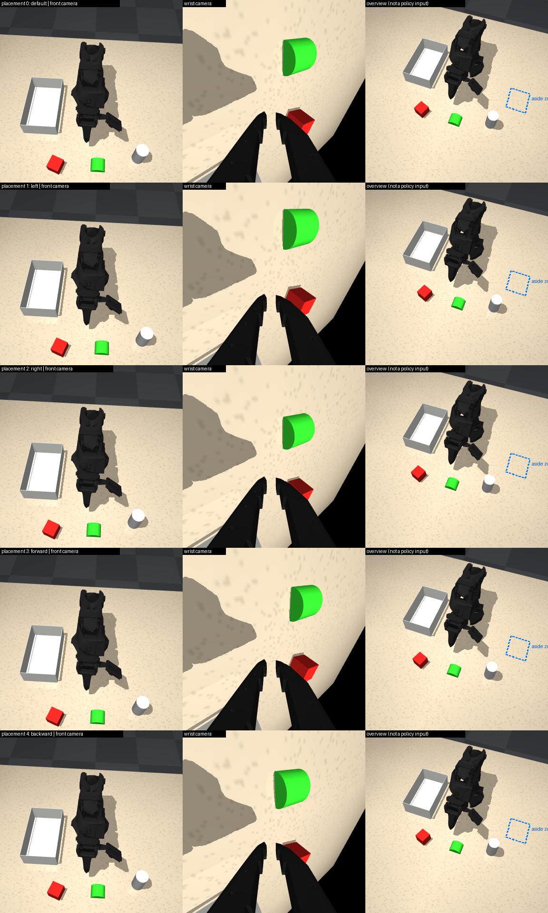

# so101_tri: three language-conditioned tasks in one scene

One tabletop scene (a white tray fixed on the robot's right, an all-red cube, a green half-cylinder, a
light gray cylinder), exactly five initial placements, three tasks, 100 physically executed demonstrations per task,
and four SmolVLA fine-tuning jobs that evaluate every saved checkpoint in the simulator. The environment is built like
`stack_red_on_blue`: a layout and tasks in the task registry, the scripted IK expert, the `generate` CLI and the shared
SLURM driver. Definitions: `so101_libero/tasks/tri_tasks.py` (geometry, directions, placements, tolerances, tasks)
and `so101_libero/expert/tri_tasks.py` (demonstration controllers).

History:
- 2026-10-21, second version of the suite. The first one (`cube_left`, `green_into_box`, `cylinder_flip`, with a white
  box on the robot's left) was retired: its objects stood too close to each other and to the arm, and the cylinder
  flip needed three grasps and a regrasp station. The older tray-on-the-left tasks (`red_cube_to_white_tray`,
  `red_cube_far_to_white_tray`) were removed at the same time. Retired task ids keep their seed slots.
- 2026-10-23, after the first models were tried on the real arm. Grabbing the green block in its pose and the thin
  cylinder from straight above was too hard, so `green_into_tray` became `green_push_forward` (push the green block
  5 cm forward), and the `cylinder_aside` demonstrations now use a side grasp (the wrist turned so the wrist camera is on
  top). The scene itself is unchanged, so the `cube_flip` data and models stay valid; its demonstrations are
  bit-identical. New jobs train 80k steps.



Rows: the five placements. Columns: front camera (the policy's 256x256 view), wrist camera (policy input), and an
overview with the aside zone drawn in (not a policy input).
Example demonstrations (front | wrist, as recorded in the datasets):
- [cylinder aside](media/tri_tasks/expert_cylinder_aside_seed1300000_p0.mp4)
  ([key frames](media/tri_tasks/expert_cylinder_aside_seed1300000_p0_keyframes.png))
- [cube flip](media/tri_tasks/expert_cube_flip_seed1420000_p2.mp4)
  ([key frames](media/tri_tasks/expert_cube_flip_seed1420000_p2_keyframes.png))
- [green block pushed forward](media/tri_tasks/expert_green_push_forward_seed1600000_p0.mp4)
  ([key frames](media/tri_tasks/expert_green_push_forward_seed1600000_p0_keyframes.png))

## Directions

All placements and goals are built from one `Directions` object (`TRI_SCENE.directions`). Directions are in the
robot's own frame, never the table edges:

| name | world vector | meaning | in the front image |
|---|---|---|---|
| FRONT | +x | away from the robot base, towards the front camera | down |
| LEFT | +y | the robot's own left | right (the camera faces the robot) |
| RIGHT | -y | the robot's own right | left |

Mirroring the whole scene and its goals is one setting: `Directions(left=(0.0, -1.0))`.

## Scene (metres; world origin = robot base on the table, 3.9 cm behind the shoulder's pan axis)

| item | size | pose (default placement) | mass | collision geometry |
|---|---|---|---|---|
| white tray | 15 cm long (FRONT-BACK) x 9 cm wide x 5 cm tall outside; 1 mm walls and bottom, inside 14.8 x 8.8 x 4.9 cm; open top | centre (0.075, -0.125), fixed to the table beside the robot base on its RIGHT; no task uses it since 2026-10-23, it stays so the scene does not change | welded (n/a) | 4 wall boxes + bottom box; the bottom's collision slab also reaches 1 cm into the table (invisible) |
| gray cylinder | 3 cm diameter x 6 cm tall, upright | (0.20, 0.13): left-front | 30 g | cylinder |
| green block | half-cylinder, 3.5 cm diameter x 3 cm long, 1.75 cm tall, flat face down, extrusion axis along FRONT | (0.225, 0.03): centre-front, in front of the folded arm | 15 g | exact convex mesh (32 arc segments), stiffer contacts (solref 0.005 s, priority 1) |
| red cube | 3 x 3 x 3 cm, all red | (0.232, -0.072): right-front, yaw -20.4° (turned to face the pan axis) | 20 g | box |
| aside zone | 7 x 6 cm, not drawn in the policy's views | x 0.06-0.13, y 0.16-0.22: the robot's left, beside the base, opposite the tray (moved 2026-10-23 to where the 45° side grip reaches the table: ≥ ~18 cm from the pan axis) | n/a | none (part of the goal) |

Spacing, measured by `render_placements` over all five placements:
- objects ≥ 5.8 cm apart between footprints (~10 cm centre to centre);
- 17.9-21.6 cm from the shoulder's pan axis;
- every object ≥ 3.4 cm from the folded arm at rest and while it unfolds (the closest: the green block and the
  jaw in placement 4);
- every object ≥ 5.1 cm from the tray.

Friction is 1.0 (torsional 0.005, rolling 0.0001), like every other item in this project. Masses and friction are
assumptions, not measurements. The tray is welded to the world (fix the real one to the table). The cameras are the
project's (measured front camera, wrist camera on the gripper's camera mount) and are unchanged.

**Five placements, nothing else random.** The cylinder, green block and cube move together. The tray, aside zone,
table, robot base and cameras never move. Orientations never change. The arm starts in the fixed folded rest pose, as
in `stack_red_on_blue`.

| id | name | group translation | cylinder | green block | cube |
|---|---|---|---|---|---|
| 0 | default | 0 | (0.20, 0.13) | (0.225, 0.03) | (0.232, -0.072) |
| 1 | left | 1 cm LEFT | (0.20, 0.14) | (0.225, 0.04) | (0.232, -0.062) |
| 2 | right | 1 cm RIGHT | (0.20, 0.12) | (0.225, 0.02) | (0.232, -0.082) |
| 3 | forward | 1 cm FRONT | (0.21, 0.13) | (0.235, 0.03) | (0.242, -0.072) |
| 4 | backward | 1 cm BACK | (0.19, 0.13) | (0.215, 0.03) | (0.222, -0.072) |

`env.reset(options={"placement_id": k})` selects a placement; without it the placement is drawn from the reset seed.
`info["placement_id"]` and `env.init_state["placement_id"]` report it. `python -m so101_libero.cli.render_placements`
checks all five ([results](results/tri_tasks/placements_check.json), all pass):
- settled positions equal the nominal ones (< 1 mm) and orientations are unchanged;
- every object rests on the table, touching only the table;
- the spacing above (gaps between objects, to the tray, to the pan axis, to the arm at rest and while unfolding);
- every object, the tray and the aside zone lie inside the 256x256 front image;
- each task's expert succeeds from each placement.

## Tasks

All three use the same compiled scene and placements (suite `so101_tri`, registry indices 13, 14 and 16). Success means every
goal predicate holds for 10 consecutive control steps (0.33 s, settled). Tolerances live in `TriTolerances`.

| task id | instruction | goal (privileged state, `tasks/base.py`) | horizon |
|---|---|---|---|
| `cylinder_aside` | Pick up the light gray cylinder and put it aside. | `OnTableInRegion(aside_zone)`: centre inside the zone, standing upright (≤ 15°) directly on the table, ≥ 6 cm from its start; carried ≥ 2 cm high and released within 3 cm of where it rests (carried there, not shoved); no robot contact, < 2 cm/s, TCP ≥ 4 cm away. `Undisturbed(cube, green)`: each ≤ 2 cm moved, ≤ 20° tilted, untouched, not in the tray | 450 steps (15 s) |
| `cube_flip` | Pick up the red cube and flip it onto its side. | `TurnedOnSide`: the face that started on top within 15° of vertical, i.e. facing sideways (upside down does not count), and the cube lying flat on a face (≤ 15°) directly on the table, ≤ 2 cm (horizontal) from its start; carried ≥ 2 cm high; released, < 2 cm/s, TCP ≥ 4 cm away. `Undisturbed(cylinder, green)` | 450 steps |
| `green_push_forward` | Push the green semicircular block forward 5 cm. | `PushedBy`: displaced 5 cm FRONT ± 1 cm and ≤ 1.5 cm sideways from its start; still lying on its flat face (≤ 20°) directly on the table; never carried in the jaws higher than 1 cm (pushed, not picked up); no robot contact, < 5 cm/s (the light mesh block can rock in place at up to ~2 cm/s in the simulator), TCP ≥ 4 cm away. `Undisturbed(cylinder, cube)` | 450 steps |

The environment tracks each object's orientation from the start of the episode, so the cube's turn is measured on
the body, not guessed from the image.

### `cylinder_right_of_cube` (added 2026-10-31, registry index 24)

| task id | instruction | goal | horizon |
|---|---|---|---|
| `cylinder_right_of_cube` | Put the light gray cylinder to the right of the red cube. | `OnTableInRegion(right_of_cube)`: centre in the zone 20-26 cm FRONT, 11.5-18 cm RIGHT, upright, ≥ 6 cm from its start, carried ≥ 2 cm high, released where it rests, TCP ≥ 4 cm away. `RightOf(cylinder, cube)`: ≥ 4 cm to the robot's right of the cube, ≤ 3 cm in front of or behind it, the cube moved ≤ 1 cm. `Undisturbed(cube, green)` | 600 steps (20 s) |

Same compiled scene (identical scene hash, so every other dataset and model stays valid), but its own start layout
(`TRI_CYLINDER_SPREAD_LAYOUT`): the cube and the green block at their default placement, the cylinder ANYWHERE in a
4 x 6 cm rectangle (19-23 cm FRONT, 11-17 cm LEFT; 2 x 3 cells of 2 cm that consecutive seeds cycle through) instead
of the five 1 cm placements. Why: the cylinder_aside policy, trained on +-1 cm, starts on the real arm only when the
cylinder lies within ~3 cm of its one trained image spot. The rectangle is as large as the side grasp allows: nearer
the pan axis than ~18.5 cm it does not reach the table, and from 24 cm FRONT on the cylinder leaves the front image.
The expert is cylinder_aside's side grasp (`PlaceUprightAt`), carried over the green block and the cube; it succeeded
60/60 (goal reached at steps 270-310, demonstrations 380-425 steps with the return to rest). Expert renders from six
starts: `outputs/debug/cylinder_right_of_cube/expert_starts.png`. Dataset `local/so101_tri_cylinder_right_100`
(100 plain demonstrations, seeds 2,400,000+), job `slurm/train_smolvla_cylinder_right.slurm` (80k steps).

## Demonstration controllers (`so101_libero/expert/tri_tasks.py`)

The expert stack is the project's: damped-least-squares IK at every control step with checked convergence, min-jerk
timing under the 75°/s joint-speed cap, and collision-checked poses. Physics checks run at every phase boundary
(grasped, lifted, still held, placed). Actions are absolute joint targets through the position actuators; grasps are
purely frictional (nothing is welded, attached or teleported). Every demonstration unfolds from the rest pose (the
unfold is collision-checked against the objects), does the task, parks at rest again and holds 2 s, so the policy
learns to stop.
- **cylinder_aside (side grasp):** after unfolding, first turn the wrist so the wrist camera is on top (the jaws open
  while turning). Then move to a pre-grasp 4.5-5.5 cm back along the approach axis, which is tilted 45° from vertical
  in the vertical plane through the pan axis (the steepest side approach this 5-DoF arm reaches at every placement).
  Slide in along that axis with the jaws open around the cylinder, 3.3-3.7 cm up (just above its middle), and close
  them across it horizontally. Lift until its bottom is 5-6 cm up, carry it to a random free spot in the aside zone
  (≥ 2 cm inside the zone's edges and ≥ 2 cm from other items) where every pose of the plan is reachable, lower until
  it is 2-4 mm above the table, release, back out 5 cm along the approach axis, park. The gripper keeps one
  orientation the whole time it holds the cylinder, so the cylinder stays upright.
- **cube_flip (one grasp):** the cube faces the pan axis, so a gripper whose approach is tilted 45° outward (in the
  vertical plane through the pan axis, the only plane the 5-DoF arm can aim in) closes across its two side faces. Lift
  to a TCP height of 9-10 cm, then roll the wrist 180° about the tilted approach axis: the cube turns 90° (its top face
  ends up facing the robot, its outer face ends up down). Lower over its start spot and release. After the roll,
  the wrist-camera mount hangs below the TCP on the robot side, so the release happens at the lowest collision-free
  height, a ~2 cm drop onto the new face. Retreat, park. The roll direction that stays collision-free (and the release
  height) is checked before the grasp.
- **green_push_forward:** close the gripper while unfolding and point it straight down, both closed fingers side by
  side across the push direction. Their outer edges form a flat ~2.4 cm face, centred on the block's centre line,
  with the wrist camera in front watching the block. (With the moving jaw leading, its slanted face turned the block
  by up to 25°; the wrist roll cannot reach the fixed jaw leading.) Lower behind the block, 4-8 mm from its back face,
  with the gripper's lowest point 3.7-5.7 mm above the table. Push forward in a straight line at 4 cm/s by 5 cm plus that gap
  (± 2 mm), back off 1.5 cm, lift, park.

Expert success from the start states (physics only, 10 seeds x 5 placements): cylinder_aside 50/50 (side grasp, 330-355
steps, goal first holding at step 217-244, in-hand slip ≤ 1.4 mm), cube_flip 50/50 (358-382 steps, step 238-261,
slip ≤ 1.3 mm), green_push_forward 50/50 (273-291 steps, step 141-162; pushed 4.85-5.2 cm, ≤ 0.5 cm sideways,
turned 5.5° on average, at most 20°). Each count includes the park and the 2 s hold. Failed attempts are discarded and retried with the next seed.

## Demonstration collection

```bash
# local runtime matching the cluster (python 3.10, lerobot[smolvla] 0.4.2, transformers 4.57.6, mujoco 3.3.7):
conda create -n so101lm -c conda-forge python=3.10 ffmpeg=7.1.1 && conda activate so101lm
pip install "lerobot[smolvla]==0.4.2" "transformers==4.57.6" "mujoco==3.3.7" threadpoolctl
# (on the cluster: bash scripts/setup_conda_env.sh, or simply submit a training job, which runs it)

# look at the scene / launch the environment
MUJOCO_GL=cgl python -m so101_libero.cli.render_placements --task cylinder_aside --out outputs/placements --expert-check
MUJOCO_GL=cgl python -m so101_libero.cli.render_video --task cube_flip --seeds 1420000 --placement 2 --out outputs/videos
python -c "import so101_libero; from so101_libero.env import SO101TabletopEnv; env = SO101TabletopEnv('cube_flip'); \
obs, info = env.reset(options={'placement_id': 2}); print(info, {k: v.shape for k, v in obs.items()})"

# 100 successful demonstrations per task = exactly 20 per placement (MUJOCO_GL=cgl on macOS, egl/osmesa on Linux).
# Cluster / Linux: the defaults (AV1 video, LeRobot's parallel encoders) are fine:
python -m so101_libero.cli.generate --tasks cube_flip --demos-per-placement 20 --workers 8 --repo-id local/so101_tri_cube_flip_100
# macOS laptop (how the datasets below were made): H.264 video, because LeRobot's default SVT-AV1 3.0 encoder crashes
# intermittently on macOS when an encoder is destroyed (libdispatch semaphore trap, kills the process); and a small
# window, because finished episodes wait in memory until written:
python -m so101_libero.cli.generate --tasks cylinder_aside --demos-per-placement 20 --workers 4 --window 4 \
    --vcodec h264 --encode-in-process --repo-id local/so101_tri_cylinder_side_100
python -m so101_libero.cli.generate --tasks green_push_forward --demos-per-placement 20 --workers 4 --window 4 \
    --vcodec h264 --encode-in-process --repo-id local/so101_tri_green_push_100
# combined multitask dataset (300 demonstrations)
python -m so101_libero.cli.merge_datasets --out-repo-id local/so101_tri_v3_multitask_300 \
    --repo-ids local/so101_tri_cylinder_side_100 local/so101_tri_cube_flip_100 local/so101_tri_green_push_100
# inspection: LeRobot loader, features, timing, videos, open-loop replay of 10 episodes in the simulator
python -m so101_libero.cli.validate_dataset --repo-id local/so101_tri_v3_multitask_300 --replay-episodes 10
```

Datasets go to `$HF_LEROBOT_HOME/<repo-id>` (LeRobot format v3.0, lerobot 0.4.2). On a SLURM node, a training job
generates any missing per-task dataset itself, with the same settings.

Every dataset has the same policy interface as all other datasets in this project:
- `observation.images.front` and `observation.images.wrist`: 256x256 RGB video, in that order;
- `observation.state`: the 6 `so101_follower` joint positions, in degrees with the gripper at 0-100
  (`use_degrees=True` units);
- `action`: absolute joint targets in the same units;
- 30 fps, and `task` = the natural-language instruction of the episode.

Per-episode metadata:
- per-frame `placement_id` and `collection_seed` (int64; LeRobot never feeds non-`observation.*` keys to a policy);
- `meta/so101_libero_episodes.jsonl`: task id, instruction, placement id and name, seed, initial state, phases and
  grasp-quality metrics;
- `meta/so101_libero.json`: generation config, per-placement attempts/successes, seed ranges, code hash and a source
  snapshot.

Seeds: task slot k uses `k * 100,000 + placement * 10,000 + i` (cylinder_aside 1,300,000+, cube_flip 1,400,000+,
green_push_forward 1,600,000+; slot 15 belonged to green_into_tray). Each placement keeps its first 20 successes in
seed order, independent of the worker count. Evaluation states: `init_states/<task>.json`, 50 per task (10 per
placement, seeds 11,300,000+ / 11,400,000+ / 11,600,000+), all solved by the expert (0 candidates rejected).

The SLURM jobs generate the training datasets. A local run on the Mac (H.264, 2026-10-23) collected 100
demonstrations per task with no rejected attempt (20 per placement in 20 attempts): cylinder_aside with side grasps
34,174 frames (326-355 per episode, 91 MB) and green_push_forward 28,248 frames (271-293, 76 MB); cube_flip 37,081
frames (352-386) on 2026-10-21. `validate_dataset` passed for all three: 10 replayed episodes each reproduce the
recorded joint states exactly and end with the goal holding. Merging the three passes the merge's frame check, and
the balanced sampler then gives each task 37,081 slots per epoch. The local cube_flip copy still shows the cube's old
white top face (removed 2026-10-22; the motions are unchanged). The multitask job reuses whatever
`local/so101_tri_cube_flip_100` exists on the cluster, so that copy must be one generated after 2026-10-22.

## Multitask data and sampling

lerobot 0.4.2 cannot train on several repo ids (`make_dataset` raises `NotImplementedError`), so `merge_datasets`
builds one combined dataset with LeRobot's own `aggregate_datasets`:
- tasks are re-indexed by instruction string, so every frame keeps its own instruction;
- it first checks that fps, robot type and features (camera keys and order, joint names) are identical;
- normalization statistics are aggregated by LeRobot;
- file rotation is switched off (one video file per camera). In lerobot 0.4.2, a rotation points every episode of a
  multi-file source at the last destination file, so frames decode from the wrong file or past its end (this broke the
  first version's multitask job on the cluster). After merging, the first and last frame of every episode are decoded
  from the merged dataset and compared with its source, and any mismatch fails the merge.

The three tasks' episodes differ in length, so plain uniform frame sampling would favour the longest. The multitask
job therefore trains with `python -m so101_libero.train.lerobot_train_balanced` instead. This is `lerobot-train`
itself (same arguments, checkpoints and resume), with the dataset wrapped so that every task has the same number of
sample slots per epoch. Each sample is still a real frame with its own instruction. The mapping is written to
`<output_dir>/task_balancing.json`.

## SmolVLA fine-tuning (SLURM, one H100 96 GB, one job per run)

| script | data | steps | output dir / log |
|---|---|---|---|
| `slurm/train_smolvla_cylinder_side.slurm` | 100 side-grasp cylinder demos (`local/so101_tri_cylinder_side_100`) | 80k | `outputs/train/smolvla_tri_cylinder_side_100` / `liberomini-so101lm-smolvla-cyl-side-<jobid>.out` |
| `slurm/train_smolvla_green_push.slurm` | 100 push demos (`local/so101_tri_green_push_100`) | 80k | `outputs/train/smolvla_tri_green_push_100` / `liberomini-so101lm-smolvla-green-push-<jobid>.out` |
| `slurm/train_smolvla_multitask.slurm` | all 300 (`local/so101_tri_v3_multitask_300`), tasks sampled equally | 80k | `outputs/train/smolvla_tri_v3_multitask_300` / `liberomini-so101lm-smolvla-tri-multi-<jobid>.out` |
| `slurm/train_smolvla_cube_flip.slurm` | 100 cube-flip demos (`local/so101_tri_cube_flip_100`); already trained, no need to rerun | 100k | `outputs/train/smolvla_tri_cube_flip_100` / `liberomini-so101lm-smolvla-cube-flip-<jobid>.out` |

Each script is a thin wrapper, like `slurm/smolvla_stack_red_on_blue.sbatch`, around the shared driver
`slurm/smolvla_job.sbatch` (the former `smolvla_red_cube_to_white_tray.sbatch`, now task-neutral). The driver's
stages:
1. environment (conda env via `scripts/setup_conda_env.sh`, or `ENV_ACTIVATE`);
2. evaluation states (`init_states/<task>.json`, committed) and a scene-hash check;
3. dataset: used if present, else generated (per task) or merged (multitask);
4. validation (10 replayed episodes);
5. training;
6. **evaluation of every saved checkpoint** (`EVAL_CKPTS=all`, the default in `slurm/tri_tasks.env`).

Training settings:
- fine-tunes `PRETRAINED` (default `lerobot/smolvla_base`), never from scratch;
- `--steps=80000` optimizer updates for the cylinder, push and multitask jobs (100k for cube_flip), cosine LR decay
  over the same number of steps;
- `--save_freq=20000`: checkpoints 020000, 040000, 060000 and 080000 (and 100000 for cube_flip), all kept;
- BF16, batch 32 (configurable with `BATCH_SIZE`);
- front/wrist renamed to `camera1`/`camera2`; each sample's instruction is the language input.

Evaluation: after training, each saved checkpoint runs on the task's 50 frozen start states in the simulator
(episode k = state k, which uses placement k mod 5, so 10 per placement). Results go to
`$OUT/eval/<step>/results.json` (success rate per task with a 95 % interval, counts of where the object ended up),
`episodes.csv` (one row per episode: index, seed, success, steps, outcome) and 10 videos. The job log ends with a table of all checkpoints
(`python -m so101_libero.cli.summarize $OUT/eval/*/results.json`). The multitask job evaluates every checkpoint on all
three tasks. A checkpoint takes ~15 min per task: the 80k per-task jobs need ~3.5-4 h of training plus ~1 h of
evaluation, the multitask job ~3.5-4 h plus ~3 h (12 h limit). If a job hits its time limit, resubmit the same command: training
resumes from `checkpoints/last` (`--resume=true`, restoring the optimizer, scheduler and RNG state) and finished
evaluations are skipped. `EVAL_CKPTS=last` or `none` shortens a job.

Site settings (scratch dir, environment activation, pretrained checkpoint, dataset ids, batch size, evaluation,
account/partition) are in `slurm/tri_tasks.env`. Nothing is submitted automatically.

```bash
# from the project root on the cluster; account/partition either on the command line, or in slurm/tri_tasks.env
# (SBATCH_ACCOUNT / SBATCH_PARTITION) and then `( source slurm/tri_tasks.env && sbatch <script> )` in a subshell:
sbatch --account=<account> --partition=<partition> slurm/train_smolvla_cylinder_side.slurm
sbatch --account=<account> --partition=<partition> slurm/train_smolvla_green_push.slurm
sbatch --account=<account> --partition=<partition> slurm/train_smolvla_multitask.slurm
sbatch --account=<account> --partition=<partition> slurm/train_smolvla_cylinder_right.slurm   # not in the multitask
# larger batch (fits in 96 GB; give it more time):  BATCH_SIZE=64 sbatch --time=20:00:00 slurm/train_smolvla_green_push.slurm
```

Recommended: push the code and submit; each job generates its dataset on the cluster (20 demos per placement, AV1,
~0.5-1 h on the node before training). The three jobs can be submitted together: a per-dataset lock makes the
multitask job wait for a per-task dataset that a single-task job is generating, then reuse it; it reuses the existing
cube_flip dataset. Copying the Mac
datasets (`rsync -a ~/.cache/huggingface/lerobot/local/so101_tri_* <cluster>:~/so101lm/datasets/lerobot/local/`)
skips the generation, but the job re-validates every dataset by replaying episodes in the simulator, and episodes
made on the Mac (arm64) may not replay exactly on the cluster's Linux nodes. A failed validation stops the job before
training.

The dataset ids and output dirs of the changed tasks are new, so earlier ones on the cluster are never picked up.
Those that no current job uses can be deleted (paths assume the defaults `SCRATCH_ROOT=~/so101lm` and the project
root as the working directory; keep `so101_tri_cube_flip_100` and `smolvla_tri_cube_flip_100`):
```bash
rm -rf ~/so101lm/datasets/lerobot/local/so101_tri_{cylinder_aside,green_into_tray}_100* \
       ~/so101lm/datasets/lerobot/local/so101_tri_v2_multitask_300* \
       outputs/train/smolvla_tri_{cylinder_aside,green_into_tray}_100 outputs/train/smolvla_tri_v2_multitask_300
```


## Running a trained policy on the real SO-101

Copy the run from the cluster (`outputs/train/smolvla_tri_*`) to this Mac's `outputs/train/`, then:
```bash
RUN=smolvla_tri_cylinder_side_100 CKPT=080000 TASK=cylinder_aside bash scripts/real_smolvla.sh
RUN=smolvla_tri_cube_flip_100 CKPT=100000 TASK=cube_flip bash scripts/real_smolvla.sh
RUN=smolvla_tri_green_push_100 CKPT=080000 TASK=green_push_forward bash scripts/real_smolvla.sh
RUN=smolvla_tri_v3_multitask_300 CKPT=080000 TASK=cube_flip bash scripts/real_smolvla.sh   # one model, any of the three
RUN=smolvla_tri_cylinder_right_100 CKPT=080000 TASK=cylinder_right_of_cube bash scripts/real_smolvla.sh
```

The script sends the exact training instruction for each task id (any other `TASK` text is sent as is). Set up the
table as in simulation, measuring forward from the shoulder's pan axis (the vertical axis of the base motor) and
sideways from the robot's centre line:
- start with the arm folded at rest;
- white tray fixed with its centre 3.6 cm in front of the pan axis and 12.5 cm to the robot's right, long side
  pointing forward;
- gray cylinder standing 16.1 cm in front, 13 cm left;
- green block 18.6 cm in front, 3 cm left, flat face down, its long axis pointing forward;
- red cube (3 cm, all red) 19.3 cm in front, 7.2 cm right, turned 20° so one face points at the pan axis;
- or that group of three shifted by 1 cm;
- keep the aside zone clear: 2-9 cm in front of the pan axis, 16-22 cm left;
- keep ~6 cm of table clear in front of the green block (it is pushed 5 cm forward).

Before the real arm, `python scripts/real/run_policy.py --robot sim --task-id cube_flip --policy <checkpoint>` runs the
same policy loop in the simulator.

## Files

Suite files:
- `so101_libero/tasks/tri_tasks.py`: scene configuration, directions, placements, tolerances and the three tasks
  (registered in `tasks/registry.py`, slots 13, 14 and 16).
- `so101_libero/expert/tri_tasks.py`: the three demonstration controllers.
- `so101_libero/cli/render_placements.py`: renders and checks of the placements (spacing, clearances, image, experts).
- `so101_libero/cli/merge_datasets.py`: the combined multitask dataset.
- `so101_libero/train/lerobot_train_balanced.py`: task-balanced `lerobot-train`.
- `slurm/train_smolvla_{cylinder_side,cube_flip,green_push,multitask}.slurm` and `slurm/tri_tasks.env`.
- `init_states/{cylinder_aside,cube_flip,green_push_forward}.json`.
- `docs/TRI_TASKS.md`, `docs/media/tri_tasks/`, `docs/results/tri_tasks/`.

Shared code extended for it (the remaining tasks are unchanged: their scene and rules hashes still match
`init_states/`):
- `sim/objects.py`: half-cylinder mesh shape, containers fixed to the table, per-object contact softness.
- `sim/scene.py`: mesh assets and fixed containers.
- `tasks/base.py`: `FixedPlacementLayout`; predicates `TurnedOnSide`, `PushedBy` and `Undisturbed`; plans
  `PlaceUprightAt`, `PushBy` and `TipOver`; start-orientation tracking.
- `tasks/registry.py`: seed slots that survive removals (`retire`, `seed_slot`).
- `env.py`: `placement_id`.
- `expert/rollout.py`: expert dispatch by plan, placement ids, grasp monitor through the roll.
- `cli/generate.py`: `--demos-per-placement`, per-task episode limit, `--window` / `--encode-in-process` (memory),
  `--vcodec` (H.264 on macOS).
- `data/writer.py`: per-frame episode metadata.
- `cli/{render_video,make_init_states,check_reproducibility,evaluate}.py`: placements, seed slots, expert dispatch.
- `scripts/real_smolvla.sh`: the three task ids and their instructions.
- `slurm/smolvla_job.sbatch` (renamed from `smolvla_red_cube_to_white_tray.sbatch`): required `TASKS` / `REPO_ID` /
  `OUT`, plus `PRETRAINED`, `TRAIN_LAUNCHER`, `DATASET_ROOT`, `MERGE_FROM`, `ENV_ACTIVATE` and a per-dataset generation
  lock. `smolvla_red_cube_to_black_box.sbatch` and `smolvla_stack_red_on_blue.sbatch` run it with their old defaults.

Removed: the tasks `cube_left`, `green_into_box`, `cylinder_flip`, `red_cube_to_white_tray` and
`red_cube_far_to_white_tray` (2026-10-21) with their predicates and plans (`MovedBy`, `FlippedInPlace`, `MoveBy`,
`FlipViaStation`) and the white tray of `sim/objects.py`; `green_into_tray` (2026-10-23) with `RestingInContainer`,
`PlaceInBox` and its controller `BoxPlaceExpert`; and their init states, SLURM jobs, media and results.

## Limitations

- **The cube flip ends with a ~2 cm drop.** After the 180° roll, the wrist-camera mount (4-8 cm beside the roll axis)
  hangs below the TCP on the robot side, so the gripper cannot lower the cube to the table from its middle. It
  releases at the lowest collision-free height and the cube falls ~2 cm onto its new face. All 50 test attempts land
  flat within 2 cm, but a real cube may bounce differently.
- **Only one flip direction is demonstrated.** The single tilted grasp always tips the cube towards the robot (its
  top face ends facing the robot). The goal accepts any side, but the data shows one.
- **A flipped all-red cube looks the same as an unflipped one.** Success is judged from the simulator's tracked body
  orientation, not the image. The final parked frame of a demonstration looks like its first frame, so the policy
  (which has no memory) cannot see that the flip is done and may start another one. A simulator evaluation stops at
  success, so the success rates are unaffected. On the real robot, stop the run after the first flip (`DURATION` or
  Ctrl+C).
- **The cube must face the pan axis.** It is turned -20.4° so that the 45° tilted grasp closes across two faces. A
  real cube placed square to the table edges is not the trained start state.
- **The pushed green block ends at the edge of the front camera's view.** It starts 220-242 rows down the 256-row
  front image, and 5 cm further forward it sits at about rows 250-273, mostly cut off (fully out in the "forward"
  placement). The wrist camera watches it during the whole push and still sees it after parking. Moving the block back
  would change the scene for every task, including the trained cube_flip.
- **The side grasp is tilted 45°, not horizontal.** A horizontal approach at the cylinder's middle is out of reach
  for this 5-DoF arm unless the cylinder is ~27 cm or more from the pan axis. 45° works at every placement, and the
  cylinder must be held at the same tilt until it is released, so the aside zone moved to where 45° reaches the table
  (≥ ~18 cm from the pan axis).
- **The push depends on friction.** Table and block friction (1.0 here) set how far the block coasts and whether it
  turns. A real block on a slippery table may slide past 5 cm.
- Object masses and friction, the contact softness and the green block's stiffer contacts are not identified from
  the real objects. The 1 mm tray walls are thin collision geometry (fine for gentle contacts).
- The demonstrations are scripted and differ only in timing, heights, release points, push gap and (for the
  cylinder) the spot in the aside zone; the start states are the five placements. There are no recovery demonstrations: the base
  expert's `--max-grasp-retries` / `--miss-prob` are not wired into these controllers.
- Datasets collected on macOS (CGL rendering, H.264 video) are valid but not bit-identical to ones generated on the
  Linux cluster (EGL/OSMesa rendering, AV1 video); training decodes either with `--dataset.video_backend=pyav`. Do not
  merge datasets with different codecs (the merge refuses differing features).
