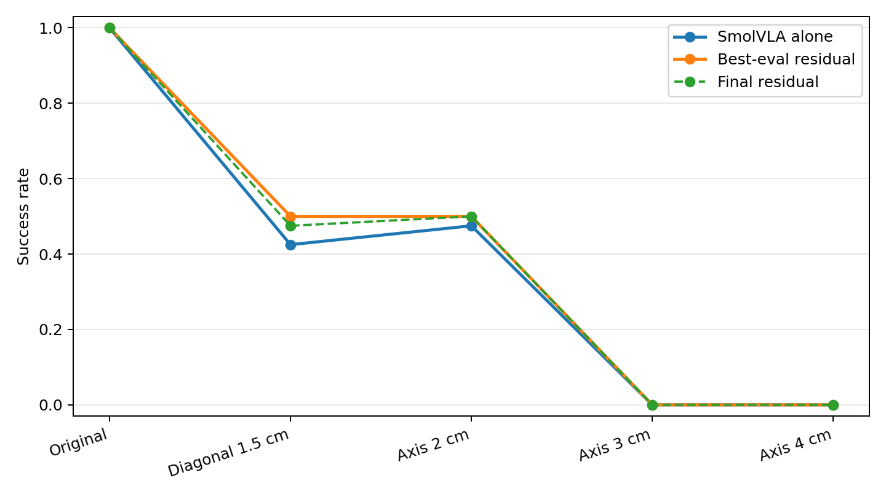
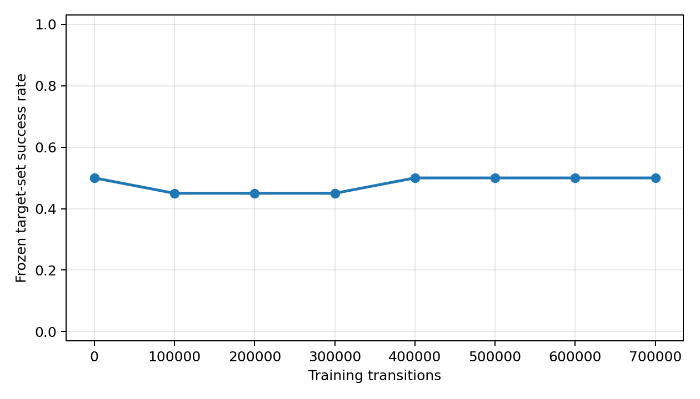

# Final residual evaluation

| set | SmolVLA | best-eval | final | best delta | best stalled / moved / lifted |
|---|---:|---:|---:|---:|---:|
| Original 50 | 50/50 | 50/50 | 50/50 | +0 | 0 / 0 / 0 |
| Axis 2 cm | 19/40 | 20/40 | 20/40 | +1 | 20 / 0 / 0 |
| Diagonal 1.5 cm | 17/40 | 20/40 | 19/40 | +3 | 20 / 0 / 0 |
| Axis 3 cm feasible | 0/30 | 0/30 | 0/30 | +0 | 20 / 0 / 10 |
| Axis 4 cm feasible | 0/30 | 0/30 | 0/30 | +0 | 10 / 20 / 0 |

Target paired best-eval: fixed=4, broken=0, McNemar exact p=0.125.
Target paired final: fixed=3, broken=0, McNemar exact p=0.25.

Success intervals and complete episode records are in `results.json`.

